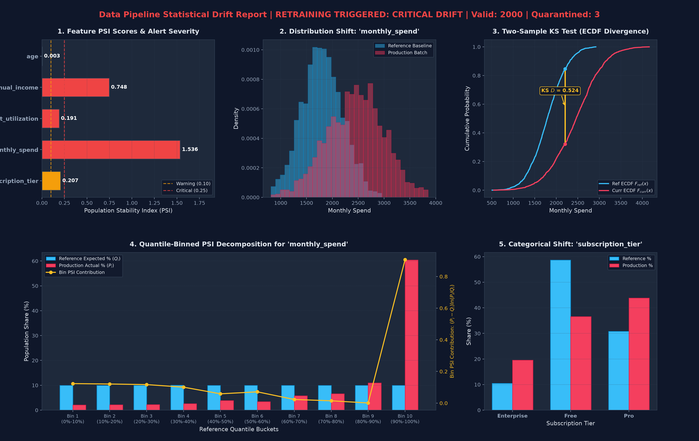

# 🛡️ Production-Grade Data Ingestion & Statistical Feature Drift Pipeline

[](https://www.python.org/)
[](https://docs.pydantic.dev/latest/)
[](https://github.com/)
[](https://opensource.org/licenses/MIT)
[](https://github.com/psf/black)

A modular, self-healing Python architecture that decouples **row-level contract enforcement** (using Pydantic v2 and Dead-Letter Queue routing) from **distribution-level statistical drift monitoring** (using Two-Sample Kolmogorov-Smirnov tests and Quantile-Binned Population Stability Index).

---

## 📊 Visual Diagnostic Dashboard

The pipeline automatically generates publication-grade multi-panel visual reports and standalone interactive HTML dashboards upon batch execution:



*Figure 1: Automated 5-panel diagnostic dashboard generated from `python drift_pipeline.py`, showcasing PSI threshold severity, distribution density shift on continuous features, ECDF maximum vertical divergence ($D$), quantile-binned PSI decomposition, and categorical frequency changes.*

---

## 🎯 Executive Summary & The Core Problem

In enterprise Machine Learning Operations (MLOps), model degradation occurs through two distinct failure modes that are commonly conflated:

1. **Row-Level Data Corruption (Syntactic Failure)**:
   - Malformed records, out-of-range inputs, unexpected nulls, or negative numbers slip into production data.
   - *Consequence*: If unhandled, these corrupt downstream NumPy/SciPy mathematical aggregations or cause pipeline crashes.
2. **Distributional Covariate Shift (Semantic Failure)**:
   - The data is syntactically pristine—every record conforms to types and boundaries. However, the underlying real-world behavior has shifted (e.g., macroeconomic inflation shifts customer incomes and spend).
   - *Consequence*: **Silent model degradation**. Pydantic and relational database constraints accept the records with zero warnings, but the ML model (trained on older distributions) outputs uncalibrated, costly predictions.

### Why Existing Solutions Fail
- **Schema Validation Alone**: Completely blind to distribution shifts. An income of `$180,000` is a valid positive float, but if median income shifts from `$50,000` to `$120,000`, downstream credit models fail.
- **Statistical Monitors Without Gatekeepers**: When bad rows (outliers, `NaN`, extreme anomalies) enter statistical routines, percentile calculations and empirical cumulative distributions warp, triggering false alarms.

**This project decouples row-level contracts from distribution monitoring**, ensuring only clean data enters statistical routines while corrupt rows are quarantined into an auditable Dead-Letter Queue (DLQ).

---

## 🏗️ Decoupled 4-Stage Architecture

```
[ Raw Batch / Stream ]
          │
          ▼
┌─────────────────────────────────────────────────────────┐
│ 1. Schema Gatekeeper (Pydantic v2 + Dead-Letter Queue)  │
└──────┬───────────────────────────────────────────┬──────┘
       │ Validated Records                         │ Invalid Records
       ▼                                           ▼
┌──────────────────────────────┐          ┌────────────────────────┐
│ 2. Vectorized DataFrame      │          │ Quarantine / DLQ Store │
└──────┬───────────────────────┘          └────────────────────────┘
       │ Compare against Reference Baseline
       ▼
┌─────────────────────────────────────────────────────────┐
│ 3. Dual Drift Engine (KS-Test + Quantile-Binned PSI)    │
└──────┬──────────────────────────────────────────────────┘
       │
       ▼
┌─────────────────────────────────────────────────────────┐
│ 4. Actionable Drift Report (JSON / Retraining Trigger)  │
└─────────────────────────────────────────────────────────┘
```

### Stage Breakdown:
1. **Schema Gatekeeper (`BatchIngestionGatekeeper`)**:
   - Leverages **Pydantic v2** (compiled with Rust-backed `pydantic-core`) for microsecond-speed row contract validation.
   - Enforces bounds, strips whitespace, blocks `NaN`/`Inf`, and evaluates cross-field invariants (e.g., annualized spend $\le 5\times$ annual income).
   - Routes invalid records to a **Dead-Letter Queue (DLQ)** with precise validation error context.
   - Built-in **Circuit Breaker**: If the batch failure rate exceeds `max_failure_rate` (default 20%), processing halts immediately to protect downstream systems from upstream schema breaking changes.
2. **Vectorized DataFrame**:
   - Converts clean rows into Pandas DataFrames and NumPy arrays for zero-copy, highly optimized array math.
3. **Dual Drift Engine (`StatisticalDriftEngine`)**:
   - Compares the production batch against a frozen, validated **Reference Baseline** (e.g. the training set).
   - Runs Two-Sample Kolmogorov-Smirnov (KS) tests and Quantile-Binned Population Stability Index (PSI).
4. **Actionable Drift Report & Trigger (`SelfHealingMonitoringPipeline`)**:
   - Categorizes each feature into `STABLE`, `WARNING`, or `CRITICAL_DRIFT`.
   - Emits structured JSON diagnostics, automatically trips an automated model retraining flag (`retraining_triggered: True`), and outputs visual reports.

---

## 📐 Mathematical Foundations & Metric Rubric

### 1. Two-Sample Kolmogorov-Smirnov (KS) Test

The two-sample KS test evaluates whether the production batch and the reference baseline originate from the same continuous distribution by measuring the supremum (maximum vertical distance) between their Empirical Cumulative Distribution Functions (ECDFs):

$$D = \sup_{x} |F_{\text{ref}}(x) - F_{\text{curr}}(x)|$$

- **Null Hypothesis ($H_0$)**: $F_{\text{ref}}(x) = F_{\text{curr}}(x)$ (both batches share identical distribution).
- **Decision Rule**: Reject $H_0$ if $p\text{-value} < \alpha$ (typically $\alpha = 0.05$). Highly sensitive to median and dispersion shifts.

### 2. Population Stability Index (PSI)

PSI measures total distributional divergence across $B$ quantile bins:

$$\text{PSI} = \sum_{i=1}^{B} (P_i - Q_i) \times \ln\left(\frac{P_i}{Q_i}\right)$$

Where:
- $Q_i$ is the expected (reference baseline) proportion of records in bin $i$.
- $P_i$ is the actual (production batch) proportion of records in bin $i$.

### Standard Metric Thresholds

| Metric | Threshold Range | Operational Meaning | Action Required |
| :--- | :--- | :--- | :--- |
| **PSI Score** | $\text{PSI} < 0.10$ | **STABLE** (Negligible divergence) | No action needed. System healthy. |
| **PSI Score** | $0.10 \le \text{PSI} < 0.25$ | **WARNING** (Moderate drift) | Log warning; alert oncall MLOps channel. |
| **PSI Score** | $\text{PSI} \ge 0.25$ | **CRITICAL DRIFT** (Significant shift) | Trigger automated model retraining / incident ticket. |
| **KS $p$-value** | $p \ge 0.05$ | Fail to reject $H_0$ | Statistical equivalence. |
| **KS $p$-value** | $p < 0.05$ | Reject $H_0$ (Shift detected) | Statistically significant difference observed. |

---

## 💡 Key Advantages & Engineering Innovations

- **Decoupled Architecture**: Keeps dirty data out of statistical routines while allowing the pipeline to continue processing clean rows without crashing.
- **Pydantic v2 Performance**: Built on `pydantic-core` (Rust), executing row-level checks 5x to 15x faster than legacy Pydantic v1.
- **Reference Quantile Binning**: Bins are established using reference percentiles ($Q_i \approx 0.10$), providing uniform statistical power across skewed distributions.
- **Laplace Smoothing ($\epsilon = 10^{-4}$)**: Automatically handles empty production bins ($P_i = 0$), preventing `ln(0) = -inf` math crashes.
- **Dual-Adjudication Alert Engine**: On large datasets ($N \ge 50,000$), the KS test becomes hypersensitive, flagging tiny, practically negligible changes ($p < 0.05$). Combining KS with PSI effect sizes guarantees that automated retraining is triggered only when shifts are both statistically significant and operationally meaningful.
- **Automated Circuit Breaker**: Halts execution when failure rate spikes, preventing mass ingestion of corrupted data due to upstream schema mutations.

---

## 🛠️ Challenges Faced & Solutions Implemented

### 1. Challenge: Naive Equal-Width Binning on Skewed Variables
- *Problem*: In real-world data like `annual_income`, values follow lognormal or power-law distributions. Naive equal-width binning ($[\min, \max] / 10$) puts $>90\%$ of records in the first two buckets, blinding PSI to shifts within the primary distribution.
- *Solution*: We implemented reference quantile binning (`np.percentile(ref, np.linspace(0, 100, 11))`). Every bucket starts with an expected $10\%$ probability mass. Outer bounds are extended to $[-\infty, +\infty]$ to catch outliers.

### 2. Challenge: Empty Production Buckets Crashing PSI Math
- *Problem*: If an extreme shift or low sample size results in a production bin with zero records ($P_i = 0$), the term $\ln(P_i / Q_i)$ evaluates to $\ln(0) = -\infty$, crashing the entire monitoring pipeline.
- *Solution*: Injected Laplace smoothing with parameter $\epsilon = 10^{-4}$ and re-normalized probabilities ($\sum P_i = 1$), guaranteeing mathematical stability while preserving drift sensitivity.

### 3. Challenge: KS-Test Hypersensitivity & Alert Fatigue
- *Problem*: In big data environments ($N > 50,000$), the Two-Sample KS test flags virtually every feature with $p < 0.05$ due to asymptotic sample size power, creating alert fatigue.
- *Solution*: Built a composite adjudication rule: critical drift requires both statistical significance ($p < \alpha / 10$) and meaningful distribution divergence ($\text{PSI} \ge 0.10$).

### 4. Challenge: Dead-Letter Queue Object Serialization
- *Problem*: Pydantic v2 validation errors include internal Python exception objects in the error context (`ctx['error'] = ValueError(...)`). Standard `json.dumps()` fails with `TypeError: Object of type ValueError is not JSON serializable`.
- *Solution*: Implemented custom serialization fallbacks (`json.dumps(..., default=str)`) in the reporting engine to cleanly capture rich stack traces and error details without serialization crashes.

---

## 🏢 Enterprise Production Adoption Guide

Here is how clients and engineering teams integrate this pipeline into existing enterprise platforms:

### 1. Batch Orchestration (Apache Airflow / Prefect / Dagster)
Integrate the pipeline as a pre-scoring validation task in your Airflow DAG:

```python
from airflow.decorators import task
from pipeline import SelfHealingMonitoringPipeline
from client_integration_example import EnterpriseDriftSentinel

@task
def validate_and_monitor_batch(daily_batch: list[dict]):
    sentinel = EnterpriseDriftSentinel(failure_threshold=0.15)
    sentinel.initialize_with_training_data(load_gold_reference_dataset())
    
    report = sentinel.monitor_daily_batch(daily_batch)
    
    if report["retraining_triggered"]:
        # Trigger downstream retraining DAG
        trigger_retraining_pipeline.override(task_id="trigger_retrain")()
    
    return report["valid_record_count"]
```

### 2. Automated Model Retraining Trigger (Vertex AI / MLflow / Kubeflow)
When `retraining_triggered == True`, fire a webhook to launch a retraining pipeline with the newly drifted data:

```python
import requests

def on_drift_detected(report: dict):
    if report["retraining_triggered"]:
        payload = {
            "model_id": "customer_churn_v2",
            "trigger_reason": "Covariate shift detected by StatisticalDriftEngine",
            "drift_summary": report["feature_drift_summary"],
        }
        requests.post("https://mlops.internal.company.com/v1/retrain", json=payload)
```

### 3. Real-Time API Gatekeeper (FastAPI / Kafka Consumers)
In microservices or streaming ingestion, instantiate the `BatchIngestionGatekeeper` to isolate corrupt messages into Kafka DLQ topics:

```python
from fastapi import FastAPI, HTTPException
from schemas import CustomerFeatureRecord

app = FastAPI()

@app.post("/predict")
def predict_record(payload: dict):
    try:
        valid_record = CustomerFeatureRecord.model_validate(payload)
        return model.predict(valid_record.model_dump())
    except ValidationError as exc:
        send_to_kafka_dlq(topic="customer-features-dlq", data=payload, errors=exc.errors())
        raise HTTPException(status_code=422, detail="Record routed to DLQ")
```

---

## 📁 Repository Structure

```
.
├── drift_pipeline.py              # Standalone all-in-one runner & simulation demo
├── schemas.py                     # Module 1: Pydantic v2 data contract & DriftSeverity enum
├── ingestion.py                   # Module 2: BatchIngestionGatekeeper & QuarantinedRecord DLQ
├── drift.py                       # Module 3: StatisticalDriftEngine (KS test + PSI)
├── pipeline.py                    # Module 4: SelfHealingMonitoringPipeline orchestrator
├── visualization.py               # Visualization engine: Matplotlib dashboard & HTML export
├── client_integration_example.py  # Production enterprise client integration template
├── test_drift_pipeline.py         # Comprehensive unit test suite (16 tests)
├── LINKEDIN_POST.md               # Ready-to-publish LinkedIn post templates
├── requirements.txt               # Pinned dependencies
└── README.md                      # Complete documentation
```

---

## 🚀 Quickstart & Installation

### 1. Clone & Set Up Virtual Environment
```bash
git clone https://github.com/krishnasidhvi/python-data-drift-pipeline.git
cd python-data-drift-pipeline

python -m venv .venv
# On Windows:
.\.venv\Scripts\activate
# On Linux/macOS:
source .venv/bin/activate
```

### 2. Install Dependencies
```bash
pip install -r requirements.txt
```

### 3. Run the End-to-End Simulation Demo
```bash
python drift_pipeline.py
```

**Terminal Output:**
```
==================================================================================
PIPELINE HEALTH REPORT | Retraining Triggered: True
Valid Rows: 2000 | Quarantined (DLQ): 3
==================================================================================
      feature_name feature_type  ks_statistic  ks_p_value  psi_score       severity  drift_detected
               age      numeric        0.0090    0.999996    0.00320         STABLE           False
     annual_income      numeric        0.3635    0.000000    0.74802 CRITICAL_DRIFT            True
credit_utilization      numeric        0.1870    0.000000    0.19126 CRITICAL_DRIFT            True
     monthly_spend      numeric        0.5245    0.000000    1.53628 CRITICAL_DRIFT            True
 subscription_tier  categorical           NaN         NaN    0.20675        WARNING            True

==================================================================================
VISUALIZATION METRICS GENERATED:
  -> Static High-Resolution Dashboard: drift_dashboard.png
  -> Interactive Standalone HTML Report: drift_report.html
==================================================================================
```

### 4. Run the Unit Test Suite
```bash
python -m unittest test_drift_pipeline.py
```
```
................
----------------------------------------------------------------------
Ran 16 tests in 2.674s

OK
```

### 5. View Interactive Web Report
```bash
# On Windows:
start drift_report.html

# On macOS:
open drift_report.html

# On Linux:
xdg-open drift_report.html
```

---

## 🤝 Contributing

Contributions, issues, and feature requests are welcome! Feel free to open an issue or submit a Pull Request.

---

## 📄 License

This project is open-sourced under the [MIT License](LICENSE).
